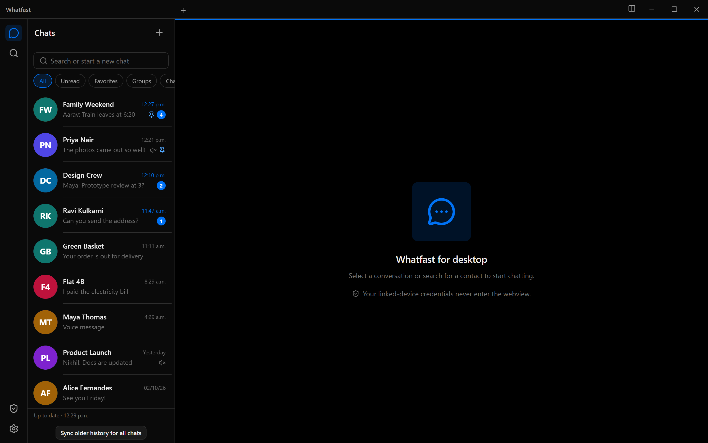
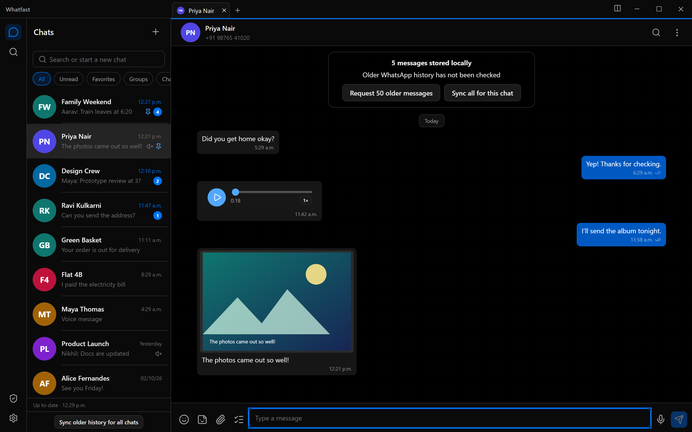
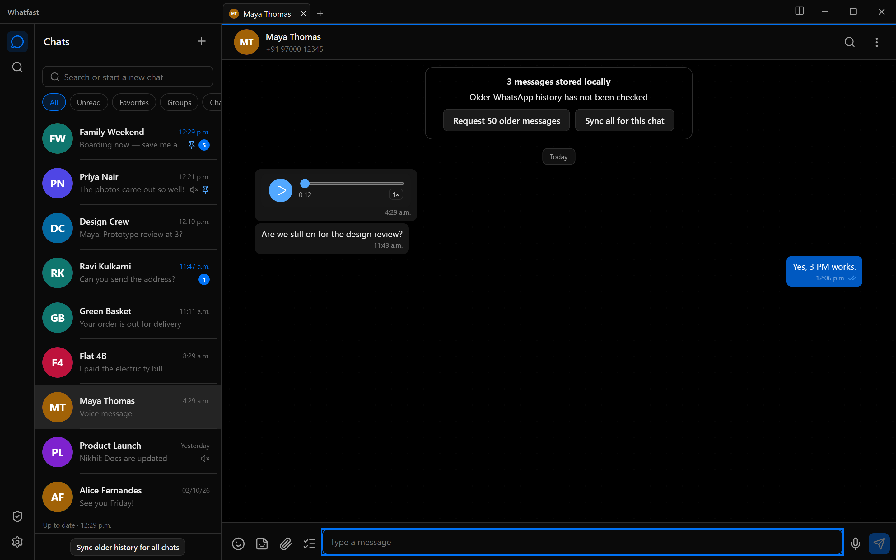
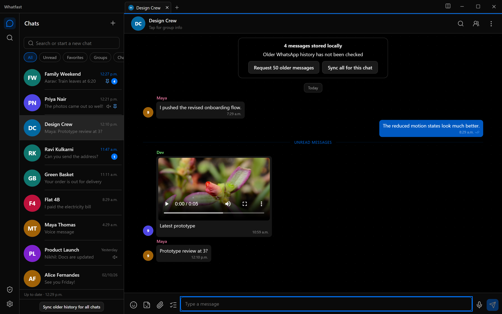
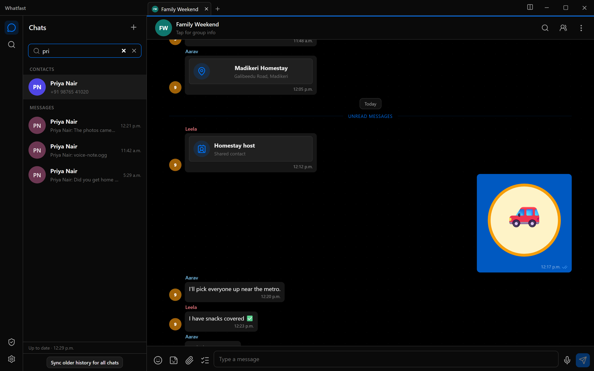
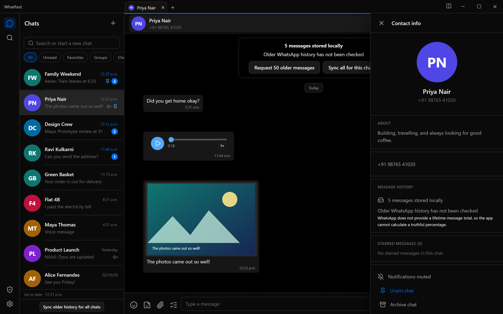
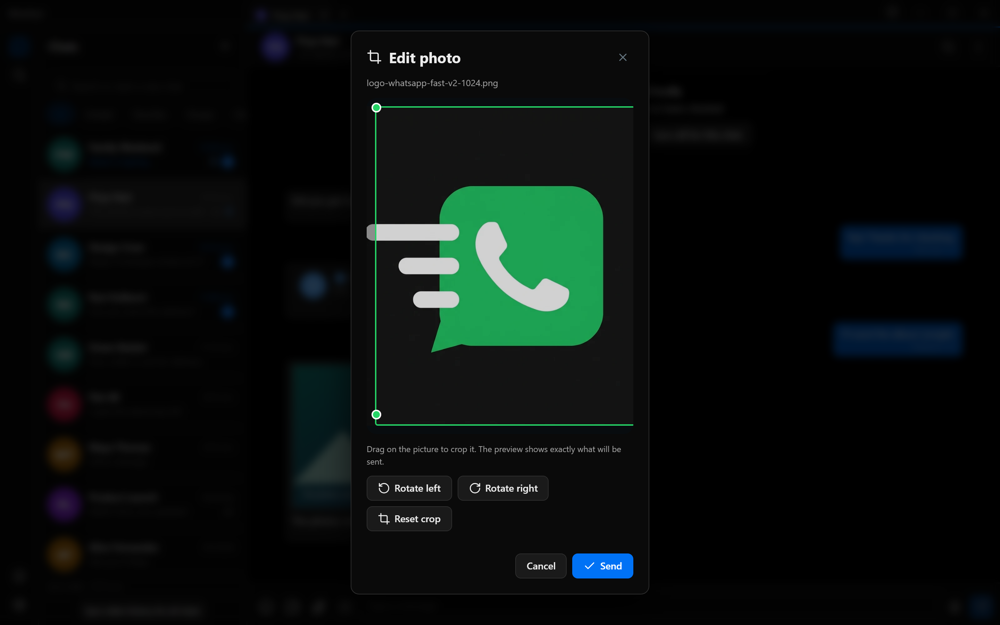
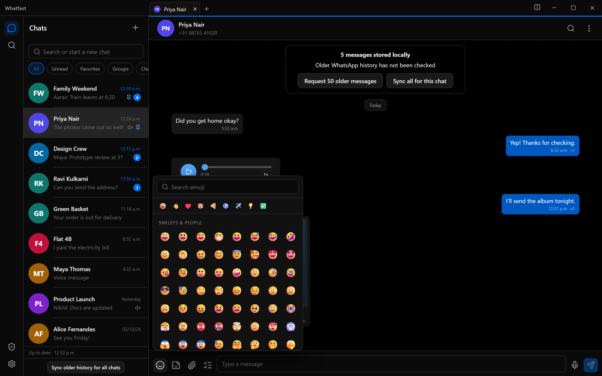

# Whatfast

Cliente de escritorio de WhatsApp, rápido y chico. No es una página web
empaquetada: es una app nativa (Tauri + Rust) con un motor Go que habla el
protocolo de dispositivos vinculados.



> **Estado:** beta privada. Es un cliente no oficial. Leé
> [Qué todavía no anda](#qué-todavía-no-anda) antes de confiarle tu cuenta.

---

## Contenido

- [Qué es](#qué-es)
- [Capturas](#capturas)
- [Quéfast contra WhatsApp Web y contra la app de Windows](#quéfast-contra-whatsapp-web-y-contra-la-app-de-windows)
- [Dónde Whatfast gana de verdad](#dónde-whatfast-gana-de-verdad)
- [Dónde todavía pierde](#dónde-todavía-pierde)
- [Cómo está armado](#cómo-está-armado)
- [Privacidad y datos sensibles](#privacidad-y-datos-sensibles)
- [Compilar y correr](#compilar-y-correr)
- [Checks](#checks)
- [Protocolo](#protocolo)

---

## Qué es

- **Webview SolidJS** para pintar: listas virtualizadas, burbujas, compositor.
- **Núcleo Rust (Tauri)** como frontera tipada: comandos, permisos, rutas.
- **Sidecar Go** (`whatsmeow`) como único dueño de la conexión, el historial, los
  medios y las bases de datos.

El webview nunca ve tus credenciales: el QR, el token del dispositivo y las
bases de datos viven en el sidecar, y el webview habla con él por RPC tipados
con protobuf.

Todo el historial es **local** (SQLite: `session.db` y `client.db`). La app te
dice siempre cuántos mensajes tiene guardados y si el historial viejo de
WhatsApp todavía no se buscó, en vez de fingir que lo tiene todo.

---

## Capturas

Todas las capturas son del **modo mock** de la propia app (sin cuenta real,
sin QR, sin red): los chats y los contactos están simulados dentro del
repositorio.

### Lista de chats

Chats, grupos, no leídos, fijados y el contador de sincronización por chat.


### Conversación con foto y nota de voz

Vista previa de imagen, nota de voz con forma de onda real, acuses de lectura y
el aviso honesto de cobertura del historial.



### Nota de voz

Reproducción con barra de progreso, velocidad y duración real del audio.



### Grupo con fotos, video y remitentes



### Búsqueda sobre contactos y mensajes



### Ficha del contacto



### Editor de imagen: recorte libre y rotación

Recorte con tiradores, rotación de 90°, y el preview muestra exactamente lo que
se va a enviar.



### Emoji y stickers



---

## Whatfast contra WhatsApp Web y contra la app de Windows

Números **medidos el 20/10/2026 en esta máquina** (Windows 11 x86-64, sin
cuenta de WhatsApp: la app de Windows no está instalada acá, así que sus
celdas quedan sin medir y se explican por estructura).

| | **Whatfast** | **WhatsApp Web** | **App de Windows** |
|---|---|---|---|
| Motor de render | WebView2 del sistema | el de tu navegador | Chromium propio (Electron) |
| Descarga para instalar | **33,1 MB** (5,4 MB la app + 27,7 MB el sidecar) | 0 (es una página) | trae su propio Chromium |
| JS que baja el cliente | **411 KB** (127 KB con gzip) | **5.948 KB** solo la pantalla de login | — |
| Primera pintura con contenido | 1,13 s (build de desarrollo) | 0,91 s | — |
| Evento `load` | — | 3,50 s | — |
| UI lista (lista de chats) | **1,16 s** (build de desarrollo) | — | — |
| Ventana visible tras lanzar | **0,25 s** | — | — |
| RAM del código propio (núcleo + sidecar) | **25,6 MB + 31,8 MB = 57,4 MB** | 79 MB de heap JS en la sola pantalla de login | — |
| RAM del motor de render | 366,8 MB (WebView2, **compartido con Windows**) | el navegador ya abierto: **612,7 MB** medidos con Brave y 6 pestañas | — |
| RAM total en reposo | **432 MB** | el del navegador + la pestaña | — |
| Base de datos | SQLite local, en tu disco | en el navegador | local, pero no tuya |
| Credenciales en el proceso del render | nunca | sí | sí |

Cómo se midió, para que puedas repetirlo:

- **Whatfast**: `build/tauri-target/release/whatfast.exe` lanzado con el
  sidecar real (`--stdio`), 30 s después se sommó el working set del árbol de
  procesos (núcleo + `whatfast-backend` + los hijos de `msedgewebview2`).
  La ventana se cuenta desde `Start-Process` hasta que aparece el handle.
- **UI de Whatfast**: Chromium headless contra el servidor de desarrollo de
  Vite; `performance.getEntriesByType("paint")` hasta la lista de chats. Son
  cifras del build sin minificar: el bundle de producción es más liviano, así
  que el número real es mejor o igual.
- **WhatsApp Web**: el mismo Chromium headless contra `web.whatsapp.com`
  (pantalla de login/QR), sin cuenta y sin iniciar sesión.

---

## Dónde Whatfast gana de verdad

1. **No te descarga un segundo navegador.** La app usa el WebView2 que ya
   viene con Windows. La app oficial de Windows trae su propio Chromium
   (Electron): son cientos de megabytes de motor duplicado en el disco.
2. **No necesita el navegador abierto.** WhatsApp Web es una pestaña más: si
   tenés 40 pestañas, la de WhatsApp se lleva su parte de RAM y de CPU. Acá
   la app son 57,4 MB de código propio y nada más.
3. **La UI pesa 411 KB.** La pantalla de login de WhatsApp Web ya baja 5,8 MB
   de JavaScript; la app oficial pesa mucho más porque va con un Chromium
   entero adentro.
4. **Arranca antes.** Ventana visible a los 0,25 s y lista de chats a los
   1,16 s, sin depender de la red.
5. **El historial es tuyo y es local.** SQLite en tu disco, con control de
   acceso y borrado explícito al desloguear. No hay copia en el navegador ni
   en un servidor de terceros.
6. **El webview no ve tus credenciales.** El token del dispositivo y las bases
   de datos viven en el sidecar Go; el render solo recibe lo que el RPC le
   pide.
7. **El scope de archivos está acotado.** El protocolo `asset` solo puede leer
   las carpetas del perfil, no todo el disco.
8. **Editor de imagen de verdad.** Recorte libre con tiradores y rotación de
   90° antes de enviar, con un preview que muestra exactamente lo que se va a
   mandar.

---

## Dónde todavía pierde

- **Sin llamadas.** El protocolo de dispositivos vinculados no expone
  señalización de VoIP: la app te avisa en vez de fingir una llamada.
- **El historial viejo hay que pedirlo.** WhatsApp no da un total de por vida,
  así que la app no puede prometer un porcentaje: te dice cuántos mensajes
  tiene guardados y te da el botón para pedir más.
- **Sin "programar envío", sin "info del mensaje", sin temporizador editable,
  sin markup ni memes, sin galería "Fotos y videos" por chat.** No están en el
  protocolo: faltan RPC.
- **No es un reemplazo de la app oficial.** Es un cliente de escritorio más
  chico, más rápido y con los datos en tu disco.

---

## Cómo está armado

```text
SolidJS + TanStack Virtual        (webview)
        invoke tipado + Channel de eventos ordenados
Núcleo Rust (Tauri 2)             (frontera tipada, permisos, rutas)
        protobuf v21, framing 4 bytes BE + longitud, máx 8 MiB
Sidecar Go 1.25 (whatsmeow)       (conexión, historial, medios, DB)
        session.db + client.db + caché de medios acotada
```

- El shell y el sidecar se **recompilan juntos**: el protocolo se versiona y
  falla cerrado.
- `proto/bridge.proto` es el contrato: 50 peticiones, 51 respuestas.
- El lado Go reduce el historial, baja y cachea los medios (512 MiB) y los
  avatares (128 MiB).
- Los previews de enlaces se resuelven en el backend (OpenGraph), no en el
  render: el webview nunca pide una URL ajena.
- Los medios salientes se stagean en `<perfil>/staged-outgoing/<uuid>/` desde
  el núcleo Rust: solo esa ruta puede llegar al backend.

---

## Privacidad y datos sensibles

Qué se revisó en el repositorio y en sus 211 commits antes de publicarlo:

| Revisión | Resultado |
|---|---|
| Tokens, API keys, claves privadas, credenciales en URL | ninguna en el árbol ni en el historial |
| `.env`, `.pem`, `.key`, archivos de credenciales | ninguno |
| Bases de datos, logs de sesión, `session.db`, `client.db` | ninguno versionado (están en `.gitignore`) |
| Binarios sueltos y artefactos de build | ninguno (`.gitignore` + `release/*.exe`) |
| Rutas con tu nombre de usuario | 3 mentions en docs, corregidos a rutas genéricas |
| Datos de contactos y mensajes | 100 % mock: los "contactos" del modo demo son fixtures del repo |
| Correos reales | solo el del autor del commit; los demás son JID de prueba (`@s.whatsapp.net`) |

Además, por diseño:

- El **QR y las credenciales del dispositivo** nunca entran al webview: se
  negocian en el sidecar y el render solo ve lo que el RPC le devuelve.
- El scope del protocolo `asset` es una lista blanca de carpetas del perfil.
- Al desloguear se borran las bases de datos (incluido el índice FTS5), se
  hace `VACUUM` y se limpian las cachés de avatares y medios.
- En Unix, el perfil y la caché se crean con modo 0700 y los archivos con
  0600.
- Un lock de perfil a nivel de sistema impide que dos procesos abran las
  mismas bases.

---

## Compilar y correr

Requisitos: Go 1.25+, Rust estable, Node.js con pnpm 10.28.2. En Linux,
los paquetes de desarrollo de WebKitGTK 4.1.

```sh
make deps        # instala el grafo de dependencias del front
make dev-fake    # levanta la app con el backend fake: 10.000 chats, sin cuenta
make dev         # levanta la app contra el sidecar Go real (aparece el QR)
make check       # go test + go vet + tsc --noEmit + cargo clippy -D warnings
make test        # go test + tests del front + build + cargo test
make build       # ejecutable release sin empaquetar
```

`make dev-fake` es el loop más rápido: no pide cuenta, no pide QR y no toca la
red. Sirve para trabajar la UI con 10.000 chats simulados.

En Windows, corré esto desde Git Bash: el Makefile compila y levanta
`build/whatfast-backend.exe`, y usar la ruta con `.exe` explícita evita que
Windows elija un sidecar viejo.

Para aislar un perfil de QA:

```sh
WHATFAST_DATA_DIR=/ruta/qa WHATFAST_CONFIG_DIR=/ruta/qa-config make dev
```

---

## Checks

| Comando | Qué cubre |
|---|---|
| `go test ./...` | 9 paquetes del backend |
| `go vet ./...` | análisis estático del sidecar |
| `pnpm check` | TypeScript estricto |
| `pnpm test` | 153 tests del front (`node --test`) |
| `cargo clippy --all-targets --locked -- -D warnings` | lints del crate Tauri y del crate GPUPI |
| `cargo check --all-targets --locked` | compilación de ambos crates |

---

## Protocolo

`proto/bridge.proto` es la única fuente de verdad. La versión actual es la
**v21** (50 peticiones, 51 respuestas). Cambiarla obliga a subir
`PROTOCOL_VERSION` en el shell y en el sidecar y a regenerar
`backend/gen/bridgev1/bridge.pb.go`: el shell y el sidecar tienen que coincidir
exactamente, porque el protocolo falla cerrado a propósito.

Lo que hay que saber antes de tocarlo:

- Los comandos de chat (archivar, mutear, bloquear) son **RPC de verdad**
  (`set_chat_archive`, `set_chat_mute`, `set_chat_block`). El estado vive en el
  perfil del escritorio, porque el transporte no expone el app-state de
  WhatsApp.
- El mute indefinido se guarda como instante lejano (`253402300799000`).
- Los medios salientes solo pueden salir de `<perfil>/staged-outgoing/`.

El detalle de implementación, los comandos directos, el troubleshooting y la
guía de QA están en [`tauri/README.md`](tauri/README.md) y en el ledger de
paridad [`docs/TAURI_PARITY.md`](docs/TAURI_PARITY.md).

---

## Licencia

Dual: [MIT](LICENSE-MIT) o [Apache-2.0](LICENSE-APACHE), a elección del
usuario.

Cliente no oficial. No está afiliado a WhatsApp ni a Meta.
